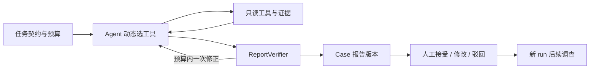

# EnterpriseIQ · Investigation Engine / Cases

M1 Alpha 已通过用户最终业务验收（2026-11-06）；M0 产品与架构基线见 `docs/`。已提供快照导入、9 个业务工具、DeepSeek 驱动的 LangGraph 调查 Agent，以及基于原始来源的结构化报告校验。

针对性修复后最新复验：冻结脚本完整业务 **8/9**，原文人工复核 **9/9**（1 项 clear/clean 同义误拒，用户已接受独立人工复核），报告校验 **9/9**，自动测试 **42 项通过**。历史首验 3/9 和修复首批 6/9 记录保留在 [验收报告](docs/M1_ALPHA_ACCEPTANCE.md)。自动评分与人工复核独立保留，原始评分脚本不变。M2 已交付并合入 main（保留功能分支 `codex/m2-investigation-enhancement`）：调查增强与 CLI 最小审核闭环，三工作空间 Web 顺延；用户已于 2026-11-06 原则认可 M2 五项交付；工程收尾、提交合并与远程同步已完成。

## 本地运行（PowerShell）

需要 Python 3.12+、uv、Docker Desktop。复制 `.env.example` 为 `.env`，替换两个位置的本地数据库密码；`.env` 已被 Git 忽略。数据库端口只绑定本机。

```powershell
uv sync --locked
docker compose up -d --wait
uv run --env-file .env enterpriseiq import-data data/enterprise-bench-data.zip
uv run --env-file .env enterpriseiq data-status
uv run --env-file .env enterpriseiq account-links ACC-013
uv run --env-file .env enterpriseiq tool calculate_arr_exposure
uv run --env-file .env enterpriseiq tool list_open_tickets --arguments '{"account_id":"ACC-013"}'
uv run --env-file .env enterpriseiq tool list_ticket_contexts --arguments '{"priorities":["p1"]}'
```

输入包来自 Apache-2.0 的 [devrev/enterprise-bench](https://github.com/devrev/enterprise-bench)，固定提交 `6220f818b0cf678471168d2c626a12fcce24ccf6` 的 [data.zip](https://github.com/devrev/enterprise-bench/raw/6220f818b0cf678471168d2c626a12fcce24ccf6/artifacts/data.zip)。将其保存到已忽略的 `data/enterprise-bench-data.zip`；导入器强制验证 M0 记录的 SHA-256。仅用于合成业务数据演示/评测，不用于训练；不分发原始数据。保留上游许可、归属和 canary 要求，见 `docs/dataset-audit.md`。

导入在单个事务中完成，相同快照重复导入不覆盖数据。源 JSON 与正文保留内容哈希；记录保留来源路径、JSON Pointer、原始字段及规范化记录哈希。所有关系绑定快照与源系统命名空间；组件数组保留多值；共享组件查询只输出候选关联。`transcript.date` 等业务日期保留在原始字段中，导入时间不替代业务时间。

只加载显式列出的业务清单及其引用正文；M0 文档、任务答案、评分标准不进入数据库。当前单一合成数据域，未实现多租户权限体系。数据库 schema 目前仅用于 Alpha 的新建本地实例。

业务工具包括客户搜索、记录读取、开放工单查询、组件工程候选、机会查询、文档检索、正文读取和 ARR 计算。输入由 Pydantic 校验，不接受任意 SQL/SOQL/JQL。查询包含快照、原始来源引用、总匹配数与分页位置；只有单次结果覆盖全部匹配时 `complete=true`，最后一页不代表前面的记录已被读取。调用方需自行累计各页。

批量 `list_ticket_contexts` 在分页工单上一次关联客户、组件名称、ARR，以及未完成工程问题的精确存在性/数量和代表记录。`enumeration_complete=false` 明示未枚举所有工程事项；数量/存在性取全不等于返回全部 Issue。支持优先级、客户与组件过滤，不针对评测任务固定实体 ID 或调用顺序。

金额使用 PostgreSQL numeric 和 Python Decimal，输出十进制字符串。每个直接组件按客户去重，全局再独立去重，不累加区域总额。未提供账户币种时标记 `UNSPECIFIED_BENCHMARK`；ARR 与机会 ACV 不合并；缺少 ARR 时不输出部分总额冒充完整结果。

模型供应方为 DeepSeek；在本地 `.env` 配置 `DEEPSEEK_API_KEY`，默认模型 `deepseek-flash`、Base URL `https://api.deepseek.com`。密钥不得写进命令行或 Git。

## 调查 Agent

```powershell
uv run --env-file .env enterpriseiq investigate 'Vantara 的扩展交易被什么阻塞，是否有承诺 ETA？请查阅原始证据。'
uv run --env-file .env enterpriseiq investigate '开放 p0/p1 工单按直接产品组件的去重 ARR 前三名是什么？'
# 最小恢复验证：首个工具执行完后持久化并退出；用上条输出的 run_id 开启新进程继续。
uv run --env-file .env enterpriseiq investigate '调查 Vantara 的交易阻塞与下一步行动' --pause-after-tool
uv run --env-file .env enterpriseiq resume <run_id>
```

两个问题走同一个 `StateGraph`：`agent → tools → agent` 循环，每次只执行模型实际请求的一个工具；批量工具请求会逐项执行、逐项 checkpoint。条件路由依据待执行工具、回答、错误与预算，不按问题关键词选择预设流程。使用 DeepSeek 原生 function calling；图状态保存工具消息、证据字典、Trace、错误与累计用量，不保存隐藏思维链。汇总结果附展示名称以减少无意义重复读取。

Checkpoint 使用独立的 `investigation_checkpoint` schema、独立 autocommit 连接和 `durability="sync"`；`resume` 从同一 run 的未完成节点继续，已结束的 run 不重新调用模型。初始化锁只保护 schema/migration，不提供后台调度。同一 run 的执行、恢复和 Case 投影由 PostgreSQL 会话锁及进程内锁串行保护，连接断开会释放数据库锁。只读工具在节点中途崩溃时仍可能重读；这不提供外部副作用恰好一次或后台调度。

默认每次调查最多 20 次工具调用、20 次模型调用、180 秒；`--max-tool-calls` 和 `--max-seconds` 可在启动时设置。恢复保留累计预算；正常保存的暂停/等待输入记录剩余执行秒数，等待不计入时间预算，再启动以剩余秒数继续。进程意外崩溃仍沿用已保存绝对截止时间，保守计入停机时间，不自动延长。预算耗尽输出 partial/failed 与已有证据，不标记为完整调查。瞬时模型错误（429、选定 5xx、超时/连接错误）最多额外重试两次，短退避和每次请求均计入原预算；401 等永久错误停止。失败尝试逐节点 checkpoint，未知的请求用量保留 `usage_incomplete=true`，已知 Token 总计只是下限。工具失败继续保留为报告缺口，不自动隐藏。

本地 `outputs/<run_id>.json` 保存工具消息、Trace、原始草稿及每次校验结果；终端输出摘要。LangSmith 外部 tracing 显式禁用。

## 证据与基本可靠性

正式报告只由通过校验的结构化主张渲染：原始字段值、逐字摘录、共享组件候选、明确文本引用、确定性 ARR 和显式 ETA 来源观测。不把模型自由文本转述自动认证为事实。引用必须来自本次成功工具返回，且能回查原始文件哈希、JSON 位置或已读取的正文行；数据库记录与原始来源不一致时拒绝发布。

集合任务使用 `table` 声明引用实际工具 call_id；校验器独立复算全部行与列后生成确定性表格，并展开可审计的原始字段/关系证明。用户要求完整工单或完整组件名称、金额、数量时，缺表、缩小集合或删除必需列不能通过。表格中的事实优先作为规范表达；数值等价或集合顺序不同的重复原子主张去重，错误主张仍会阻止报告。

ARR 另从原始账户/工单 JSON 用 Decimal 独立复算，检查筛选优先级、客户集合、去重、分组、前三名及币种。含糊的“按区域统计 ARR”要求澄清；明确的地理 ARR 聚合返回不支持，不用组件计算替代。当前确定性金额工具只支持直接产品组件和全局去重。

查询完整性按规范化参数累计各页记录 ID 和连续覆盖区间；只读第一页或最后一页、缺中间页、总数变化、正文未读完、工具请求未执行或失败，均会形成明确缺口。即使已验证部分主张也返回 partial，`formal_report=null`。无可用证据时返回 failed；只有主张、口径、查询覆盖、执行预算均通过时才返回 completed / report_validation=passed。

已观察证据中的显式 ETA 日期/未承诺状态会自动按 issue 归属检测冲突，冲突不会由模型自行挑选一方解决。当前不提供通用自然语言蕴含裁判，也不自动解决合同适用性、跨时间文本矛盾等复杂判断；原文观察与未验证问题分开保留。模型可在原预算内最多修正一次格式/字段/证据缺口，失败草稿和校验反馈全部保留；这不是无限重试。

```powershell
# 不调用模型，独立复核已保存运行；旧版自由文本草稿会被阻止直接升级为正式报告。
uv run --env-file .env enterpriseiq verify-run outputs/<run_id>.json
```

当前引擎版本为 `m2-enhancement-2`；新运行的暂停/恢复已验证。旧版本 checkpoint 不跨版本续跑，以免沿用旧报告契约；原文件仍可用 verify-run 审核，不会覆盖原始运行记录。

## 验证

```powershell
uv run pytest tests/test_dataset.py
# 在 .env 配置独立的 TEST_DATABASE_URL，指向预先创建的测试数据库后：
uv run --env-file .env pytest
```

业务集成测试逐项回滚，不修改开发数据库；未配置独立测试库或未提供数据包时会明确跳过。测试覆盖数据与业务工具，以及 Agent 预算路由、错误状态、PostgreSQL 重建连接恢复和已完成 run 的重复 resume。新增初始化竞争回归测试仅在专用 `enterpriseiq_test` 库重建 checkpoint schema，不作用于开发库。自动测试不调用付费模型；真实 DeepSeek 验证记录见 `docs/PROJECT_STATUS.md`。

运行三个代表场景各 3 次完整验收（会产生真实模型调用）：

```powershell
uv run --locked --env-file .env python scripts/accept_m1.py
```

每次使用独立 run_id，保留全部 partial/失败，记录报告状态、业务检查、调用次数、token 与墙钟延迟；销售第 3 次包含新进程恢复。问题/配置先写入 manifest，运行中检查引擎指纹不变；结果只写到已忽略的 `outputs/m1-final-*/`。评估代码及原始答案不会进入 Agent 的业务工具。


## M2：任务口径、缺口与人工审核

自然语言先形成 `task_contract`：快照、明确实体 ID、领域范围、优先级、top-N 与必需表格/原文/ETA 等。Agent 和 Verifier 使用同一契约，校验器重新推导以拒绝篡改。领域同义词仅归一化用户问题；原始证据不修改。它是有限领域解析器，不是通用语义理解服务。不支持的地理金额聚合明确停止。

```powershell
uv run --env-file .env enterpriseiq investigate '按区域统计 ARR 前三'
# 同一 run 补充口径；不重新收取一个完整执行预算。
uv run --env-file .env enterpriseiq resume <run_id> --clarification '产品组件，不是地理区域'
uv run --env-file .env enterpriseiq case-list
uv run --env-file .env enterpriseiq case-show <case_id>
# 在原 Case 创建后续调查；使用新的 run_id，保留之前快照和报告。
uv run --env-file .env enterpriseiq investigate '调查 ACC-001 的开放 P1 工单与相关工程候选' --case-id <case_id>
```

`investigation_gaps` 区分 unresolved、pending_validation 和 verified：工具成功或已观察到相关内容不代表结论已通过验证。模型每轮收到当前缺口与剩余预算，自行选择下一工具；校验结果与未验证问题写回缺口列表。Trace 保存实际参数、结果范围、错误、用量及简短行动摘要，不保存隐藏思维链。显式实体必须有已验证来源支持；要求待确认事项时不能省略问题列表。复杂业务语义仍需人工判断。



Workflow 负责预算、错误分类、恢复互斥和验证门槛；Agent 决定业务查询路径。State 中消息/错误/报告尝试使用追加 reducer，证据和 Trace 按 ID 合并；任务契约、计数、剩余时间及缺口列表采用覆盖更新。Checkpoint 保存执行状态，Case 保存业务历史，二者职责独立。

所有新 CLI 调查先在 `investigation_cases` 注册 Case/run，正常执行及恢复在运行锁内投影结果。最终报告版本绑定 run、快照、原始草稿与校验结果；`case-show` 同时提供来源元数据、Trace、缺口和审核时间。报告及审核表禁止 UPDATE/DELETE，后续运行按创建顺序确定当前审核对象，不由旧运行晚完成覆盖业务状态。

```powershell
# request-id 由调用方生成；重试同一请求必须复用，且内容完全一致。
uv run --env-file .env enterpriseiq case-review <case_id> <report_id> accept --actor local-reviewer --reason '已核对来源' --request-id <uuid>
uv run --env-file .env enterpriseiq case-review <case_id> <report_id> reject --actor local-reviewer --reason '需要补查' --request-id <uuid>
# draft 是结构化 ReportEnvelope JSON；不能提交任意文字冒充验证事实。
uv run --env-file .env enterpriseiq case-review <case_id> <report_id> modify --actor local-reviewer --reason '修订主张' --request-id <uuid> --draft outputs/edited-draft.json --opinion '人工建议，尚未自动验证'
# 不执行模型或工具，仅由 Checkpoint 重建 Case 投影；可重复执行。
uv run --env-file .env enterpriseiq case-sync <run_id>
```

修改会创建新版本并重新校验；新版本还需独立接受。无依据事实产生 blocked 版本，不能接受；旧版本和已审核版本不能再次作为新审核目标。人工意见与来源事实分开保存。接受表示本地审核决定，不代表现实行动完成，也不代表本里程碑已获用户最终验收。actor 是审计标签，不提供身份认证。

如果进程在注册后、首次 checkpoint 前退出，`case-list` 显示 registered；此时无执行状态可恢复，可在该 Case 创建新 run。已有 checkpoint、但业务投影未写入时，使用 `case-sync` 对账。M1 checkpoint 不跨版本恢复；旧运行文件可离线复核，不覆盖原始记录。

M2 综合验收复用冻结 M1 评分函数，再增加 Vantara 待确认事项和 TechFlow 客户调查各三次，并演示 CLI 修改/接受/幂等/投影恢复。此演示的 `m2-review-demo` 审核不代替用户最终验收：

```powershell
uv run --locked --env-file .env python scripts/accept_m2.py
```

全部运行记录和失败保留在忽略的 `outputs/m2-final-*`，源码指纹冻结，自动评分与独立原文人工复核分开记录。实际结果见 `docs/PROJECT_STATUS.md`。不接真实企业系统、不做多租户、Web、自动风险扫描或生产 SLA 承诺。


M2 的推进条件/行动调查另检查已读通话中显式编号的 `ACTION ITEMS`：每条完整原文需进入通过校验的引文（含原文状态/截止日期）。只验证这种明确来源清单，不推断通用文本中的全部义务；跨分页也不能漏项。报告引用均正确仍可能不完整，因此这个覆盖门槛独立于引用校验。M2 开发期旧契约 checkpoint 不跨版本执行，Case 中的原报告与证据保留。

供应方请求沿用 M1 的布局：开头为固定 system 规则，末尾为当前预算、任务契约与输出格式约束。最新校验反馈直接合并进末尾约束，防止它被后续约束遮蔽；原始反馈仍按时间保存在 State。单一开头 system 的试验没有改善真实运行，已撤回。节点拓扑和 Agent 的工具选择权不变。


M2 当前验证：63 项测试通过；最终 15 次调查报告校验 15/15，冻结自动业务评分 13/15（M1 子集 8/9、新增 5/6），两处 clear/clean 原文措辞误拒单列。Codex 原文复核 15/15（不是独立真人审核），用户已原则认可交付和两项语义复核依据；七批 105 次及失败全部保留。完整记录见 `docs/PROJECT_STATUS.md`。


## M3 本地调查工作台（交付项 1）

沿用现有引擎/工具/校验器/Case，只新增薄 API、React 界面和 PostgreSQL 单 worker 作业登记。浏览器提交后立即取得 job/run/Case ID；worker 独立执行，页面刷新或连接关闭不取消调查。请求 ID 与内容绑定，网络不确定时使用“重试原提交”，不重新发起调查。旧 CLI Case 不自动暴露到 Web。

```powershell
uv sync --locked
npm --prefix web ci
npm --prefix web run build
# 仅首次创建本地演示身份；用户及会话凭据都不得提交
uv run enterpriseiq-web-user investigator --roles investigator
uv run enterpriseiq-web-user reviewer --roles reviewer
uv run enterpriseiq-web-user viewer --roles viewer
# 终端一：界面和 API；访问 http://127.0.0.1:8000
uv run --env-file .env uvicorn enterpriseiq.web:app --factory --host 127.0.0.1 --port 8000
# 终端二：独立 worker；默认 smoke，累计受 M3 预算约束
uv run --env-file .env enterpriseiq-worker --live
# 不加 --live 不访问供应方：需模型的任务明确失败；澄清仍可零模型执行
```

登录令牌位置以 provision 命令输出为准；新建文件位于忽略的 `.secrets/<workspace_hash>/<user_id>.login.txt`，不同工作空间的同名身份不会覆盖令牌。交付项 1 已生成的旧路径令牌继续有效，不自动搬移。服务端配置只保存 SHA-256；浏览器以 8 小时 HttpOnly/SameSite=Strict 会话登录，不将令牌存入 localStorage。移除身份、修改角色或身份/工作空间绑定后重启 API 生效；旧会话不能继承新权限，需重新登录。首次升级会话绑定字段后，旧的未绑定会话也须重新登录，Case/报告/证据不变。本地 HTTP 只绑定回环地址；HTTPS 部署需 `ENTERPRISEIQ_COOKIE_SECURE=1`，部署与 SSO 不在本项范围。Vite 开发代理默认用 8000 后端；开发时将 `.env` 的 `ENTERPRISEIQ_ORIGIN` 设为 Vite 实际显示的源地址，并重启 API。

| 后端操作 | viewer | investigator | reviewer |
|---|---|---|---|
| 查看所属工作空间的 Case/版本/工具记录/原始证据 | 允许 | 允许 | 允许 |
| 创建调查、同 Case 后续调查 | 拒绝 | 允许 | 拒绝 |
| 澄清/恢复 | 拒绝 | 仅自己发起的最新 run | 拒绝 |
| 修改再校验/接受/驳回 | 拒绝 | 拒绝 | 仅他人发起的调查 |

同一工作空间的不同身份可以查看共享 Case；资源读取按工作空间授权，不提供按个人隐藏 Case 的规则。恢复权限另外绑定具体 run 的发起人；拒绝冒用别人的请求 ID，拒绝通过伪造 ID 读取或接管未映射的 CLI Case。只读 GET 仅显示作业中断状态，不更新其他用户或工作空间的数据；持久化恢复仅由发起人授权的 resume 或受信 worker 执行。

身份可兼任多个角色，但不能审核自己发起调查产生的任何报告版本。reviewer 对他人报告修改后再接受，是同一审核流程，不冒充第二次独立审核。所有检查在服务端执行，审核人来自会话；任意资源 ID 不能越过工作空间范围。当前只有本地预置身份和共享合成数据域，不宣称多租户数据层隔离或上游 ACL 已实现。CLI 持有数据库凭据，是受信本地管理入口，不通过 HTTP 暴露。 CLI 追加到 Web Case 的 run 如果没有可信发起人映射，HTTP 审核会拒绝，不能沿用较早 run 的发起人判断职责隔离。

`jobs.py/web.sql` 保存登记、幂等和作业状态；`worker.py` 复用执行锁、checkpoint 与 Case 投影。单 worker 使用独立 PostgreSQL 会话锁；异常退出后显示 interrupted，由发起人明确恢复，不自动无限重试。首个 checkpoint 前崩溃可使用原始登记状态重启同一 run；已有 checkpoint 继续采用 M2 恢复与截止时间规则。页面轮询已保存的调用/token/工具行为，不展示隐藏思维链。接受报告不触发外部系统写入。

为交付项 1 的真实冒烟先接入最小预算门槛 `budget.py/budget.sql`：累计 30 个真实调查、180 次请求、120 万 token、估算 CNY 30；smoke 最多 9 个 run、freeze 最多 21 个，任一上限先到即停。预留和结算由独立 PostgreSQL 连接提交，失败/重试/恢复不清零；未知请求保留最大预留，超预留观测会阻止后续调用。输入按请求 UTF-8 字节加 framing 余量保守预留，输出预留既有 4096 token 上限；实际用量可用后结算。费率按 2026-11-09 核验的官方 `deepseek-flash` 高峰/缓存未命中价格估算（输入 2、输出 8 元/百万 token），不是实付账单；其他模型未定价时拒绝调用。价格或预算变更不得静默重置现有账本。

交付项 4 将 Web worker、CLI investigate/resume 和原真实评测的 CLI 子进程接入同一门槛。必须配置 `BUDGET_DATABASE_URL`；所有入口指向同一预算库，即使评测改用另一业务库，也不新建或清零预算。缺配置、账本不可用、策略/模型不匹配均停止请求；原始供应方适配器也拒绝没有一次性预算凭证的 HTTP 调用。本地代码和数据库管理员仍是受信边界。

调查准入即计数（启动失败或未发模型请求也不退调查次数），同一 run 恢复不重复计数且不可切换 smoke/freeze。每个逻辑模型序号持久化预留和内容摘要；已保存响应在跨进程恢复时直接复用，同序号不同内容拒绝。进程在预留后突然退出、超时或用量不明时保留全额预留并拒绝静默重发；后续明确重试使用新的序号并再次计费。确定未发送的配置错误用量为零，但保留调查数/尝试数。结算冲突或观测超过预留会阻断新请求，保留较高费用估算供检查；不自动释放未知额度。

`enterpriseiq budget-status` 查询策略、累计值和剩余额度；`enterpriseiq run-metrics <run_id>` 查询逐次模型费用/用量与执行耗时，限受信本地操作员。`performance.py/performance.sql` 在同一 PostgreSQL 中逐次记录模型适配器、工具、来源校验、执行、排队与端到端墙钟；供应方请求耗时单列，缓存复用的适配器耗时不冒充新 HTTP 耗时。Web 端到端从每次作业提交至结果保存/作业提交结束，CLI 从处理入口至结果文件保存；不包含 CLI Python 启动、浏览器渲染或上次澄清的人为等待。计时与供应方已知 Token 为观测，金额按冻结费率估算，未知 Token 使用预留；崩溃缺失的耗时为 null/incomplete，不补零。旧 Trace 不追补未经观测的细分耗时。

`uv run --locked --env-file .env python scripts/paid_eval.py --suite m1` 默认仅检查/初始化预算，不执行调查，`--live` 才会执行保留原评分口径的旧批次（m1 9 次/m2 15 次）；预算错误立即停止并保留调用记录。直接执行旧脚本也受 CLI/适配器预算门槛约束。此入口不代表 M3 的 21 次冻结已运行；离线评测仍使用 `scripts/evaluate_m3.py`，交付项 4 未调用真实模型。

M3 最小保留规则由 `lifecycle.py/lifecycle.sql` 实施，不自动后台清理：

| 对象 | 保留与清理边界 |
|---|---|
| Trace | Case 中的原始执行状态保留；仅删除满 30 天、与 Case 归档完全相同的 UUID 命名本地副本。未登记、不同内容、非法路径和冻结验收引用的文件不删 |
| Checkpoint | 满 30 天的终态、无待执行节点、与 Case 完整投影一致且无待恢复作业，才删除该 run 的 checkpoint/blobs/writes；冻结验收引用的 run 保留 |
| Case / 报告 / 审核 | 无限期保留；不提供 Case 删除或压缩原始状态功能，原不可变历史约束保持 |
| 数据快照 | 审计基线及 Case/报告/Trace 引用的快照保留；其他快照满 90 天且无引用才按依赖顺序删除。存在未知 checkpoint 或不可解析 Trace 时保守阻止快照清理 |

维护入口为 `uv run --locked --env-file .env enterpriseiq-maintain --reason "本次维护原因"`；默认 dry-run，仅写维护审计。明确加 `--apply` 才删除符合规则的副本。必须单独配置 `MAINTENANCE_DATABASE_URL`；没有应用凭据回退，不提供 Web 维护路由，viewer/investigator/reviewer 无维护授权。数据库管理员或明确加入 `enterpriseiq_maintenance` 数据库角色且获得所需表权限的受信维护用户才能运行；该角色由管理员单独创建/授权，程序不会自动授予权限。当前本地数据库所有者是受信管理员；此边界不防范数据库超级用户。

先停止 worker；维护锁与逐 run 执行锁保护清理，运行中的 CLI、暂停、澄清、近期和未投影状态均保留。操作记录实际数据库身份、会话身份、原因、策略、候选与保护原因；删除前记录逐项 intent，完成后才标记 completed。失败保留 failed/intents，不假装文件系统与数据库可以原子提交；需检查审计后再重试。审计、预算账本和 Checkpoint 退役记录不清理，已完成审计禁止覆盖/删除。清理后恢复返回 `checkpoint_retired`，仍可查看 Case、报告、审核、归档 Trace 和原证据。

接入契约验证复用既有 `read_bundle/import_bundle/BusinessTools`，新增/更新/删除/关系变化生成独立测试快照，旧快照与引用不覆盖；缺来源、错误哈希、重复 ID、非法路径、悬空关系均拒绝。来源后来损坏时证据读取返回明确 409，不改写原审核历史。测试只在独立数据库使用变更夹具；没有真实 CRM/Jira 接入、增量同步调度或跨快照 Agent 调查能力，当前生产引擎仍只接受冻结审计快照。

```powershell
uv run --locked --env-file .env pytest -q --tb=short
npm --prefix web test
npm --prefix web run build
```

新增 worker 集成测试使用由测试身份创建的独立 `enterpriseiq_m3_test_<uuid>` 数据库，结束后只删除该数据库；需本地测试角色具备建库权限，绝不删除开发库。自动测试只替换外部模型，实际工具、原始来源校验、Case 及 PostgreSQL checkpoint 均参与验证。运行证据与浏览器截图保存在忽略的 `outputs/`，阶段实测结果见 `docs/PROJECT_STATUS.md`。


## M3 分级评测与版本恢复（交付项 3）

普通小修先做受影响的确定性测试；调查/报告行为变化再用已有失败 Trace 离线复验；必要时才运行少量真实冒烟；21 次冻结验收保留到阶段冻结或重大行为变化。本项不执行真实模型调用。无付费入口：

```powershell
# 现有历史批次全部读取；不执行 Agent，不恢复 checkpoint，不改写原始评分/Trace
uv run --locked --env-file .env python scripts/evaluate_m3.py
# 三类新增业务场景、离线评测保护与恢复故障注入；仅外部模型使用替代物
uv run --locked --env-file .env pytest tests/test_m3_evaluation.py tests/test_m3_scenarios.py tests/test_m3_recovery.py -q --tb=short
```

离线命令仅通过只读数据库事务执行当前 ReportVerifier，并调用原封不动的 M1/M2 冻结评分函数；两份评分脚本以既有 SHA-256 固定，变更即拒绝评测。每次写入新的忽略目录 `outputs/m3-offline-<time>-<id>/replay.json`，保留原始评分行、输入哈希、当前校验缺口、当前自动评分及历史复核文件引用。缺 Trace、无效 JSON、身份不一致、重复 run、截断结果或未知场景均明确列出，不从分母删除。不同开发版本的历史批次不能合并成生产成功率；早期 M1 的 results/reviewed_results 也分别保留，不用当前评分覆盖原历史。

三个新增产品场景位于独立评测脚本，不进入 Agent 工具或检索数据：ACC-004 全部开放 P2 工单的实体/优先级/分页/金额范围；客户修复/ETA 证据不足及不可信来源指令；ISS-032 的冲突 ETA 来源。故障测试覆盖漏页、错误客户、篡改金额、工具超时、缺失正文、虚构完成状态和冲突来源遗漏。注入文档只存在于测试事务或独立测试库，不污染开发快照。新场景有单独的确定性产品检查轨道：正确保留证据缺口或冲突可以通过预设的拒答检查，不能把所有 blocked 当通过；来源/报告校验、自动业务检查和复核始终分开。

恢复采用精确匹配：保存状态（包括已登记、尚无 checkpoint 的队列输入）的 engine_version 和 snapshot_id 必须等于当前值，task_contract 必须含正确类型的版本并与当前问题重新推导的契约一致。当前为 `m2-enhancement-2`、固定合成快照和任务契约 v1；本项未改图状态结构或图拓扑，因此未伪造一个新的可迁移版本。任何未来不兼容的状态/工具/报告协议变更必须更新引擎版本并另行验证，不能继续沿用相同版本号。

同版本持久化状态可以在新进程继续，累计模型/工具计数、证据和剩余预算保留；已完成 run 重复恢复不重新执行工具。旧版本、缺版本、未来契约或快照不匹配在模型/工具调用和状态写入前拒绝。worker 分别报告 `checkpoint_engine_incompatible` / `checkpoint_snapshot_incompatible` / `checkpoint_contract_incompatible`，保持旧 checkpoint 和业务历史，不再冒充可重试的 interrupted；需要执行时明确创建后续 run。离线原文复验可以读取旧 Trace，但不使旧 checkpoint 可恢复，也不把它升级为当前正式报告。

确定性故障测试只证明约束与校验门槛；未证明真实模型在新业务问题或来源指令下的表现。Codex 的代码/来源复核不称为独立真人审核。未来发生真实调用前仍须检查统一预算及剩余额度；旧 CLI/评测入口统一预算接入属于交付项 4，不能借本离线命令绕过预算启动付费评测。
