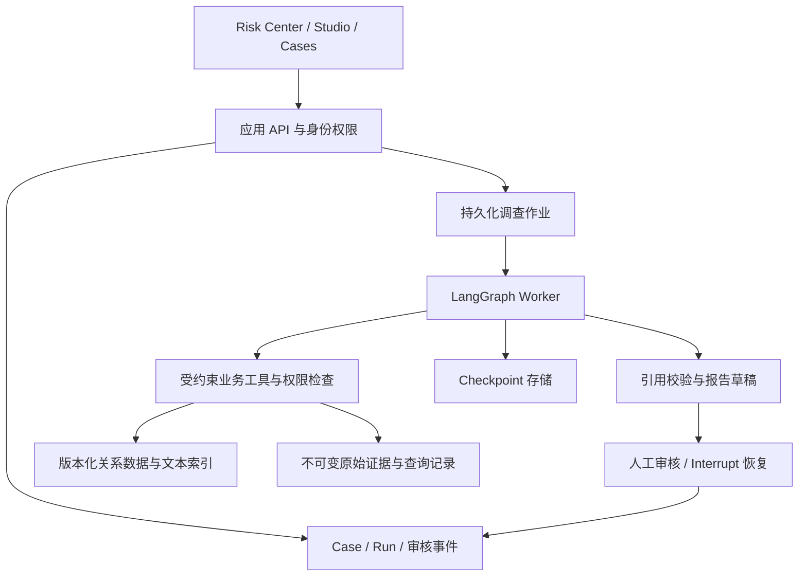

# Investigation Engine 候选架构（M0）

调研日期：2026-11-05。本文为设计建议；LangGraph 能力已按官方文档核对，未安装或运行验证。数据约束来自 [数据审计](dataset-audit.md)，待验证项见 [技术风险](technical-risks.md)。

## 方案比较与推荐

| 方案 | 优点 | 主要代价 | 本项目判断 |
|---|---|---|---|
| 固定 Workflow + 模板报告 | 查询与指标稳定，易复查、预算明确 | 难处理交易阻塞、文本矛盾与临时证据缺口 | 用作结构化任务基线 |
| Agent 自主选择原始协议工具 | 对新问题灵活，接近官方工具任务 | 容易误用协议、漏页、无限探索；统计与权限难靠提示保证 | 保留为受控评测对照 |
| Workflow 控制边界 + 有限 Agent 调查 | 确定性计算和开放式综合各司其职，支持人工决策 | 需要定义状态、证据协议和恢复边界 | **推荐候选**，由 M1 验证复杂度是否值得 |

推荐依据：本包具备可靠的结构化关联键，但工具存在截断/解析限制；交易阻塞又确实需要通话正文。不能把所有工作都交给自然语言推理。官方也区分预定路径的 Workflow 和动态决策的 Agent；该区分支持职责划分，不证明本设计已经有效。[Workflows and agents](https://docs.langchain.com/oss/python/langgraph/workflows-agents)

## 系统边界

建议以模块化单体起步，API 与调查 worker 为可分别运行的进程，共享 PostgreSQL。持久化作业在启动图前登记，避免 API 接受后进程退出导致任务无记录。Checkpoint 不承担调度、认证或完整业务事务。

三个存储职责独立：Checkpoint 保存可恢复执行状态；Evidence 保存来源原文、查询及返回范围；Case 保存报告版本和人工决定。它们可以共用数据库实例，但使用独立表/Schema、生命周期和访问控制。Case 与 checkpoint 双写需要可重试、可对账的状态转换，不能假定天然原子。

## 企业数据连接与关联（建议）

初期使用**固定快照导入 + 统一业务查询层**；原始包只读保存，导入时保留上游 ID、字段、来源路径、内容哈希和快照版本。关系查询不依赖向量相似度，文本检索补充承诺和解释。

| 连接路径 | 采用位置 | 取舍 |
|---|---|---|
| 本地快照→关系表/关联表→业务工具 | 推荐用于产品验证 | 统计易验证、无需每次 Agent 学协议；不能宣称原样完成官方 MCP 基准 |
| 官方 MCP→协议 adapter→相同业务工具 | 后续一致性检查与基准对照 | 保留分页、字段转换和部分查询语言的真实限制 |
| Agent 直接查询任意 SQL/SOQL/JQL | 仅隔离的对照实验 | 灵活，但查询和权限面扩大；不作为产品默认 |

规范实体键使用 `(tenant_id, source_system, entity_type, source_id)`；本包的 PART-ID 可直接匹配，真实源系统需要单独 mapping、有效期和匹配依据。人名、标题用于展示/评测语义匹配，不用于替代实体主键。

关系至少区分 `explicit_foreign_key`、`shared_component`、`text_reference` 和 `human_confirmed`。Issue→Part→Ticket→Account 是候选影响链；文本提及与审核可增加依据，不能无条件升级为根因。数据导入保留 components 数组的关联表，即使当前每条只有一个组件。

建议工具围绕业务意图，如查客户档案、列出开放工单、查组件工程候选、读取文档、计算去重敞口。输入使用类型约束，状态/优先级转换和分页由 adapter 完成；输出统一包含来源快照、记录/文本位置、匹配数、已取数、是否完整及错误。全量统计工具必须保证取全，否则返回“未完成”，而非部分总计。

## 图的调查流程（建议）

1. **接收与界定**：验证身份、问题、客户范围、参考时间、快照版本和总预算。
2. **确定性准备**：读取相关实体与结构化指标；固定任务直接使用已定义查询。
3. **Agent 调查循环**：提出有限假设→请求允许的工具→保存证据→更新假设与缺口；不能改变权限、计算规则或总预算。
4. **校验与停止**：检查实体关系、金额、引用、覆盖范围和矛盾；证据充分则生成草稿，预算耗尽则保留部分结果及缺口，输入缺失则进入人工补充。
5. **人工审核与归档**：展示草稿和证据后暂停；接受、修改、驳回或要求继续均产生审核事件。接受报告不自动触发外部写操作。

停止依据应是问题是否得到有证据的回答、是否还有可执行的关键查询，以及时间/成本/调用预算，不采用模型自报“高置信度”作为唯一条件。不保存或展示模型隐藏思维链；展示可审计的工具行为、简短决策依据与证据。

## LangGraph 能力核验及应用责任

| 能力 | 官方能力与语义 | 本项目建议 |
|---|---|---|
| State | StateGraph 接受 TypedDict/Pydantic/dataclass；节点返回增量；每个键的 reducer 决定覆盖或合并 | TypedDict 定义图状态；工具入参/报告用 Pydantic 做运行时校验；证据按 ID 合并去重 |
| Tool calling | 模型 `bind_tools` 产生调用请求；执行器实际执行并回传关联的 ToolMessage | 工具白名单及权限在执行层；JSON 合法不代表业务正确；显式处理工具返回的错误对象 |
| Checkpoint | 以 thread_id 组织 super-step 快照，也记录节点 pending writes；可查状态/历史并恢复 | 使用持久化 PostgresSaver；将运行与数据版本关联，图状态只放必要索引和摘要 |
| Durability | sync 在推进前等待 checkpoint；async 有崩溃窗口；exit 不提供运行中每步持久化 | 可靠性验证优先 sync，再测性能；不能由此推导外部副作用恰好一次 |
| Interrupt | `interrupt()` 暂停、通过同一 thread 的 `Command(resume=...)` 恢复；恢复时所在节点从头执行 | 审核节点尽量无副作用；恢复请求校验租户、审核人、报告版本和仍待处理的中断 |
| 失败恢复 | RetryPolicy、退避、节点超时和错误路由；并行步骤的已完成写入可参与恢复 | 瞬时故障有限重试；权限错误停止；查询错误有限修正；证据不足与系统故障分别呈现 |

状态依据：[Define and update state](https://docs.langchain.com/oss/python/langgraph/graph-api-state)。工具依据：[Models — Tool calling](https://docs.langchain.com/oss/python/langchain/models#tool-calling)、[Tools](https://docs.langchain.com/oss/python/langchain/tools)。框架工具执行节点见前述 Workflows 文档；不把其自动错误处理视为业务故障策略。

持久化依据：[Checkpointers](https://docs.langchain.com/oss/python/langgraph/checkpointers)、[Persistence](https://docs.langchain.com/oss/python/langgraph/persistence)。短期 thread 状态与跨 thread Store 用途不同；初期业务长期事实存领域表，不必额外引入通用记忆。API 路径 `durable-execution` 本次访问已重定向至 persistence。

暂停依据：[Interrupts](https://docs.langchain.com/oss/python/langgraph/interrupts)。副作用必须幂等，不能将暂停理解成程序计数器原地续跑；不要用宽泛异常捕获吞掉中断机制。

恢复依据：[Fault tolerance](https://docs.langchain.com/oss/python/langgraph/fault-tolerance)、[Configure nodes](https://docs.langchain.com/oss/python/langgraph/graph-api-nodes)。当前文档标注节点 timeout/error_handler 需要 LangGraph >=1.2，节点 timeout 只适用于异步节点；采用前需锁定兼容版本并验证。重试重跑整个节点，外部提交需幂等键；未收到回执应视为结果未知，不能盲目重复写入。

候选图状态包含：`case_id/run_id`、问题、快照与参考时间、实体范围、假设/缺口、证据引用、结构化发现、预算计数、错误、报告版本和待审核请求。身份和权限由可信运行上下文注入，不能由模型设置。`thread_id` 由服务端绑定 run，不能充当访问凭据。

运行结果建议区分 completed、partial、failed、cancelled；等待人工为可恢复状态，审核驳回为业务决定。并发更新同一 run 需串行化或版本检查；预算计数需跨重试/恢复累计。图版本升级后恢复兼容性尚待验证。

## 技术栈选择与取舍（建议，未安装）

| 层 | 推荐候选 | 选择理由和替代方案 |
|---|---|---|
| 引擎/后端 | Python 3.12+、LangGraph Graph API、FastAPI、Pydantic | 与上游 Python 数据/工具便于对照；显式图利于掌握状态与恢复；TypeScript 全栈可减少语言种类，但本项目优先引擎可读性 |
| 数据与持久化 | PostgreSQL，领域表 + 原始 JSON，独立 checkpoint Schema | 跨域 join、去重和业务记录适合关系模型；SQLite 适合单机试验，难作为多用户并发默认；暂不引入图数据库 |
| 文本检索 | PostgreSQL 全文检索 + 元数据过滤 | 只有 55 篇 KB、3 份通话与少量内文档，先测召回；语义检索不足再比较 pgvector，暂不引入独立向量服务 |
| 原始证据 | 内容哈希 + 受控文件存储，元数据在 PostgreSQL | M1 可用本地目录；后续再选对象存储；引用绑定快照与片段，不能只存可变 URL |
| Web | TypeScript + React/Next.js，API 事件用 SSE | 支持三个工作空间的交互与流式状态；Streamlit 可快速试验但不作为最终交互默认；前端不得直接连接 checkpoint 数据库 |
| 作业执行 | PostgreSQL 持久化作业 + 独立 worker | 避免调查依附单次 HTTP 请求；待吞吐/调度需求出现后再比较专用队列与 Temporal，不同时引入两套编排 |
| 模型与观测 | 支持 tool calling/结构化输出的可替换模型 adapter；结构化 trace、token/延迟/错误记录 | 用相同样本比较质量、成本和数据边界后选择模型；LangSmith 可选，外发 trace 前需确认数据策略 |
| 本地运行 | 后续以 Docker Compose 提供数据库与服务；Windows 可考虑 WSL2 | 上游基准有 Docker/Make 依赖，但产品无需在 M0 搭建；部署平台暂不绑定 |

能力依据：[FastAPI features](https://fastapi.tiangolo.com/features/)、[Next.js Server and Client Components](https://nextjs.org/docs/app/getting-started/server-and-client-components)、[PostgreSQL 全文检索](https://www.postgresql.org/docs/current/textsearch-intro.html)。上表的适用性、简化基础设施的选择属于工程判断，性能尚未实测。

企业权限建议以应用身份校验、数据访问层范围约束、数据库最小权限及 RLS 共同实现。PostgreSQL RLS 默认不约束表所有者，不能以 owner/超级用户连接后宣称隔离已生效。[Row security policies](https://www.postgresql.org/docs/current/ddl-rowsecurity.html)

## 评测与可靠性设计（建议）

保留两条明确标记的评测轨道：**官方兼容轨道**走官方 MCP 和原题评分；**产品轨道**走统一业务工具和自有证据校验。不可拿后者分数声称直接复现官方榜单。

M1 先选 eng-l1-a、eng-l2-a、sales-l2-b 作代表样本，覆盖关系、精确计算与跨源综合。评测只让 Agent 访问业务数据，criteria/参考答案/调研文档不进入检索库。加入少量反例：缺文件、截断查询、工具失败、互相冲突的来源与无完成证据。

| 检查层 | 关注指标 |
|---|---|
| 确定性 | 实体集合、关系路径、金额与去重、参考时间、查询覆盖完整性 |
| 证据 | 引用可解析、片段确实支持主张、重要结论覆盖、矛盾与未知被保留 |
| Agent | 任务通过率及重复运行分布、合理拒答、对工具失败的行为、调用/token/延迟 |
| 人工 | 对调查可用性的评价、错误类型、审核修改原因；校准 LLM judge，避免单一分数 |
| 运行与权限 | 进程重启恢复、中断重复提交、重复作业、越权读取/恢复是否被阻止 |

首批建议硬门槛：确定性金额与关系符合基线、重要引用全部可解析、无虚构 ETA/完成状态、无越权、无重复审核事件；样本量、Agent 通过率阈值及性能预算在 M1 前确定。以上是验收建议，尚无测得分数。

用户值得深入理解的三个接口：**状态与 reducer 如何影响恢复、企业关联如何产生证据、评测如何区分答对与可靠执行**。普通 CRUD、前端配置和容器脚本不要求逐行阅读。
